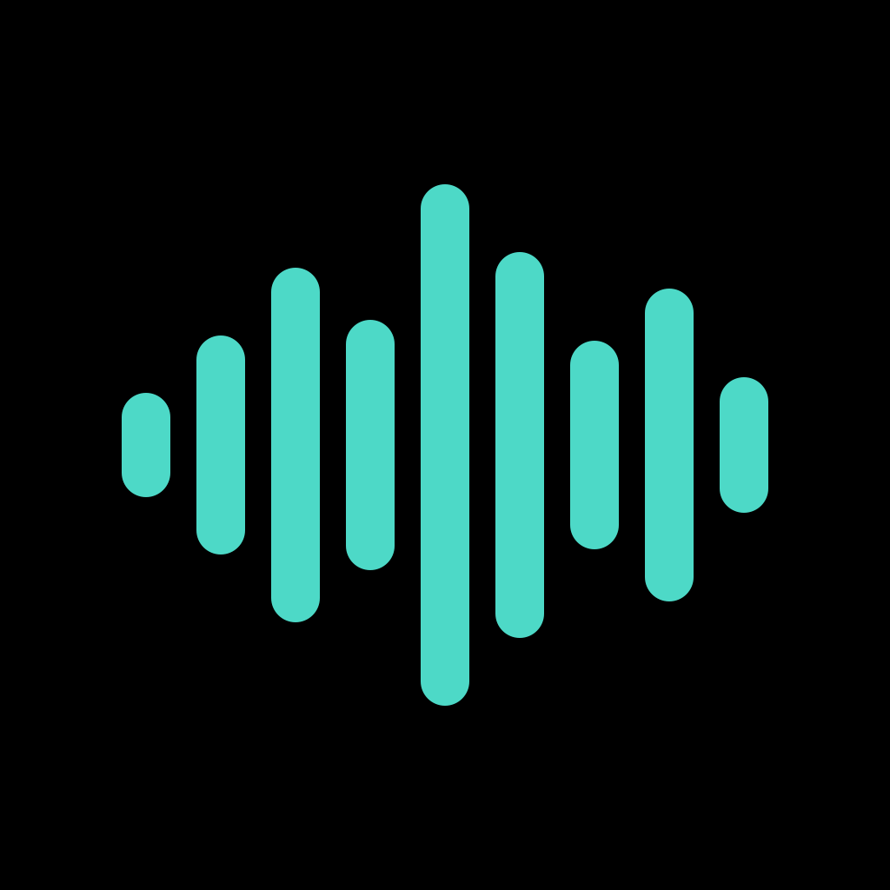

# pocket-synth

An iOS instrument app with two panels:

- a pocket **chord synth**: 7 diatonic chord pads, a chord-bending joystick, and synth modes (strum, arp…);
- an MPC-style **sampler**: pads, slicing, a sequencer and song mode.

See [docs/DESIGN.md](docs/DESIGN.md) for the architecture, and [docs/SYNTH_SPEC.md](docs/SYNTH_SPEC.md) / [docs/SAMPLER_SPEC.md](docs/SAMPLER_SPEC.md) for behavior.

## Status

Phases 0–5 (see DESIGN §10) are done. Phase 6 is done for v1 (synth tools, vocoder, and the sampler's arpeggiator, retro record, audio tracks, clips and auto-sampler); synth editors, iPad layout and AUv3 come after v1. Game and Trainer are checked in the simulator; the mic features are not checked yet.

| Area | State |
|---|---|
| Chord theory: 10 scales, 26 chord types, 5 joystick modes, voicer with inversions, voice leading, bass and slash chords | done, tested |
| Synth controller: pads, stick, chord locks, per-pad octave/inversion, all menus, tap tempo, randomize, wheel combos | done, tested |
| Synth engine: analog, FM, noise and hybrid voices; 30 sound patches; glide, vibrato; FX chain (delay, filter, tremolo, chorus, flanger, drive, tape, reverb) | done, tested |
| Sampler: 8 banks × 16 pads; 4 velocity layers per pad; one-shot/note-on; mono; mute-group choke; envelope; trim; reverse; tune | done, tested |
| Sampler UI: multitouch pads with velocity, banks, sample import and auto-assign, trim waveform editor, pad editor, mixer; project auto-saves | done, checked in the simulator |
| Clock & transport: one beat clock for everything, play/stop/record, count-in, metronome, tap tempo | done, tested |
| Synth modes: Strum, Arp (5 patterns, 3 layers, swing rates), Repeat (incl. stutter), Seq (16-step chord sequencer), Drums (7 kits, stick rolls), Beat (7 styles × 8 variations) | done, tested |
| Sampler sequencer: overdub/replace recording, Timing Correct (swing, strength), live erase, Grid editor, Note Repeat, Full Level, 16 Levels, 200-step undo | done, tested, checked in the simulator |
| Synth looper: 6 tracks up to 2 min, bar or free first take with count-in, auto-advance, hold-to-clear, tape-stop pause, Mixer mode (mute/solo/level, metronome), send a loop to the sampler | done, tested, checked in the simulator |
| Synth session (sound, settings, presets) restored on relaunch; randomize and preset save wait while a loop records | done, tested |
| Sampling: resample master / synth / sampler, or the mic; threshold arm, pre-roll, meter, trim silence, auto-assign | done, tested; resampling checked in the simulator (mic not yet) |
| Chop: hits (transient detection), regions, BPM grid (with tempo detection), smart (drag a window over the rough spot and the slice snaps to where the sound starts), manual markers; convert to pads, new samples, or pads + sequence | done, tested, checked in the simulator |
| Processes: normalize, gain, fades, crop/delete/silence, reverse, trim silence, pitch shift, time stretch, bit crush, mono, remove DC — each an undoable new version | done, tested |
| Phase 6 sampler: track arpeggiator, retrospective record, audio tracks, clip program, auto-sampler | built, unit- and render-tested; Retro and the Clips editor checked in the simulator |
| Phase 6 synth: Tuner, Mic mode (pitched sample in Lead), ear Trainer (6 levels), rhythm Game (10 songs, 5 tiers, practice speed), 12-band vocoder (MIC / LOOP) | built, unit- and render-tested; Game and Trainer checked in the simulator; Tuner, Mic and vocoder not yet checked with a real mic |
| Phase 5: MIDI in/out/clock (incl. looper MIDI), multi-track sequencer (drum / keygroup / synth / MIDI tracks), keygroups + auto-map, Pad Perform, List & Step editors, Song mode + Next Sequence, submixes / returns / XY FX, automation + Q-Links, export (WAV, stems, MIDI file) | built, unit-tested; only partly checked in the simulator |

Synth sounds named after acoustic instruments are synthesized stand-ins for now.

The first time you use the mic, iOS asks for microphone access. It's only switched on while something uses it: the Sample view with the mic source, the Tuner and Mic modes, or the vocoder set to MIC.

## Run the tests (works with just the Command Line Tools)

```bash
cd Packages/PocketSynthKit && swift test
```

## Build the iOS app

1. Open `PocketSynth.xcodeproj` in Xcode.
2. In the PocketSynth target's **Signing & Capabilities** tab:
   - pick your Team (a free Apple ID works);
   - change the bundle ID from `com.example.pocketsynth` to something unique.
3. Choose your iPhone (or a simulator) and press Run.
   - Free-account builds expire after 7 days.
   - On first install, trust the developer profile on the phone under Settings → General → VPN & Device Management.

Command-line simulator build:

```bash
xcodebuild -project PocketSynth.xcodeproj -scheme PocketSynth -destination 'generic/platform=iOS Simulator' build
```

Imported samples live in the app's Documents folder under `PocketSynth/`, which is visible in the Files app (On My iPhone → PocketSynth).
